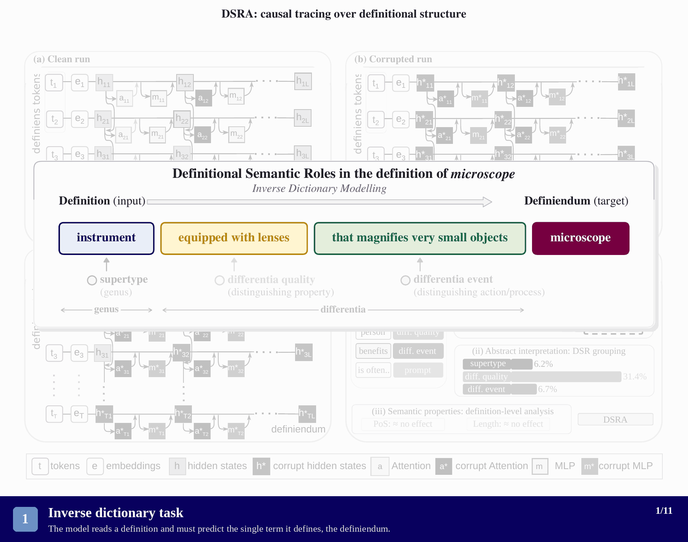

# Bridging Linguistic Structure and Mechanistic Interpretability for Conceptual Interpretation in Language Models
[](https://www.python.org/downloads/)
[](https://www.gnu.org/licenses/gpl-3.0)

This repository contains the code for the paper "[Bridging Linguistic Structure and Mechanistic Interpretability for Conceptual Interpretation in Language Models](https://aclanthology.org/2026.conll-main.44/)" (CoNLL 2026).

## Overview

**DSRA** (Definitional Semantic Role Analysis) studies how language models compose the meaning of a definition into the concept it defines. It applies causal tracing to the inverse dictionary task and reads the restored states through definitional semantic roles (DSRs) grounded in Argument Structure Theory.

1. **Inverse dictionary task:** the model reads a definition followed by a prompt (`"{definition} is often referred to as:"`) and must predict the defined term, the definiendum, as its next token. Only correctly predicted definitions are traced.
2. **Causal tracing:** a clean run caches every internal state; corrupted runs add Gaussian noise to the definition-token embeddings; patched runs restore one clean state at a time. Hidden states are restored singly, MLP and attention outputs over a window of 10 layers.
3. **Recovery score:** each restored state is scored by how much of the definiendum's probability it brings back.
4. **DSR overlay:** definition tokens are labelled with their DSRs (supertype, differentia quality, differentia event, ...), and the highest-recovery states are grouped by role.



The paper applies DSRA to GPT-J-6B on English WordNet and BERTIN GPT-J-6B on Spanish WordNet. The same pipeline runs on the GPT-2, Pythia, Gemma, Llama, Mistral and Qwen models used in CAP and CARMA.

## Setup

Use the provided `environment.yml` with Python 3.11. From the repository root:

```bash
conda env create -f environment.yml
conda activate dsra
python -m nltk.downloader wordnet brown
```

The NLTK corpora are needed only for annotating definitions. WordNet definitions come from [saf_datasets](https://github.com/neuro-symbolic-ai/saf_datasets), installed from GitHub at a fixed commit; its data are downloaded on first use. Alternatively, install with pip: `pip install -r requirements.txt`.

Gated models (Gemma, Llama) need an accepted licence on their Hugging Face pages and a login (`huggingface-cli login`) or `HF_TOKEN` in the environment.

## Usage

Run all commands from the repository root, so that the packages can be imported. The pipeline has five steps:

```bash
# 1. WordNet definitions -> data/wordnet_data_definitions.json
python -m dataset_construction.extraction.extract_definitions --language en

# 2. (optional) cleaned pool, gloss repairs and annotations -> data/wordnet_definitions_clean.json
python -m dataset_construction.cleaning.clean_definitions --repair --annotate

# 3. (paper models) LoRA fine-tuning and next-token evaluation -> output/
python -m finetuning.finetune --preset gptj_english

# 4. per-model fact file of correctly answered definitions -> data/facts_<model>_n800.json
python -m dataset_construction.facts.build_facts --model_name gpt2-large

# 5. causal tracing -> results/ns3_r0_<model>/causal_trace/
python -m tracing.trace --model_name gpt2-large --fact_file data/facts_gpt2-large_n800.json
```

Then aggregate the traces:

```bash
python -m analysis.summarise check --results results         # sanity checks
python -m analysis.summarise topk-mass --results results     # top-K recovery mass
python -m analysis.summarise cross-model --results results   # localisation per kind
python -m analysis.summarise plot                            # layer-distribution figure
```

For GPT-J-6B, trace with the paper's fixed noise (3σₑ = 0.12922): `python -m tracing.trace --model_name EleutherAI/gpt-j-6B --fact_file <facts> --noise_level 0.12922460585832596`. A fine-tuned model is traced by passing its merged weights folder as `--model_name`, with `--template` for the fact builder.

`run_dsra_models.sh` runs steps 4 and 5 for the pretrained cross-model set (see [cross-model runs](docs/cross_model.md)):

```bash
N_FACTS=25 bash run_dsra_models.sh     # pilot
bash run_dsra_models.sh                # GPT-2 Large, Qwen2.5-3B, Gemma-2B, Llama-3.2-3B
bash run_dsra_models.sh ch6            # Pythia-1B, Llama-3.2-1B, Qwen2.5-1.5B
```

Main tracing arguments:

| Argument | Purpose |
| --- | --- |
| `--model_name` | Hugging Face id or local folder of the model to trace. |
| `--fact_file` | Fact records to trace (from step 4). |
| `--noise_level` | Noise rule: a float, or `s3` for 3 times the embedding spread (default). |
| `--window` | MLP / attention window; default 10 for 28+ layers, scaled to depth below that. |
| `--torch_dtype` | `auto`, `float32`, `float16` or `bfloat16`. |
| `--num_cases` | Trace only the first N facts. |

Models can be named by their Hugging Face id or by the short names used in CAP and CARMA (`GPT2_large`, `gemma_2b`, `Qwen2_5_3B`, ...).

## Outputs

| Path | Content |
| --- | --- |
| `data/wordnet_data_definitions.json` | Extracted English definitions (84,423 records). |
| `data/wordnet_definitions_clean.json` | Cleaned candidate pool. |
| `data/facts_<model>_n<N>.json` | Fact files: definition, definiendum and prompt per traced case. |
| `output/<model>/<method>/<timestamp>_*` | Fine-tuning checkpoints, weights and the correctly predicted test items. |
| `results/n<noise>_r0_<model>/causal_trace/cases/` | `knowledge_<id>.npz` (hidden states), `_mlp.npz`, `_attn.npz`: the trace grids. |
| `results/n<noise>_r0_<model>/causal_trace/pdfs/` | Trace heatmaps for the first 200 facts. |
| `analysis/outputs/` | Summaries: top-K recovery mass, grid shares, cross-model localisation and figure. |

## Modules

| Module | Guide |
| --- | --- |
| `dataset_construction.extraction` | [WordNet definition extraction](docs/extraction.md) |
| `dataset_construction.cleaning` | [Cleaning, repairs, annotation and splits](docs/cleaning.md) |
| `dataset_construction.prompts` | [Model registry and prompts](docs/prompts.md) |
| `dataset_construction.facts` | [Per-model fact files](docs/facts.md) |
| `finetuning` | [Fine-tuning on the inverse dictionary task](docs/finetuning.md) |
| `tracing` | [Causal tracing](docs/tracing.md) |
| `analysis` | [Recovery mass, localisation and run checks](docs/analysis.md) |
| `run_dsra_models.sh` | [Cross-model runs](docs/cross_model.md) |
| | [Reproducibility notes](docs/reproducibility.md) |

## Repository layout

```text
.
├── README.md
├── LICENSE
├── environment.yml
├── requirements.txt
├── dsra_method.gif             # Method animation
├── run_dsra_models.sh          # Cross-model launcher (fact files + tracing)
├── docs/                       # Usage guides for every module
├── dataset_construction/
│   ├── extraction/             # WordNet definitions, gloss merging, masking
│   ├── cleaning/               # Filters, repairs, annotation, splits
│   ├── prompts/                # Supported models and their prompts
│   └── facts/                  # Single-token filtering and zero-shot screening
├── finetuning/                 # LoRA (paper) and full fine-tuning, next-token evaluation
├── tracing/                    # Corrupt-and-restore causal tracing
│   ├── config.py               # TraceConfig, noise rules, window rule
│   ├── model.py                # Model loading, layer names, token helpers
│   ├── noise.py                # Embedding noise for the corrupted runs
│   ├── patching.py             # Patched runs and trace grids
│   ├── runner.py               # Traces a fact file, one npz per case and kind
│   ├── visualization.py        # Trace heatmaps
│   └── trace.py                # Command line
├── analysis/                   # Recovery mass, localisation, grid shares, run checks
│   └── outputs/                # Stored summaries
└── legacy/
    └── rome/                   # ROME hooks and statistics used by the tracer, unchanged (MIT)
```

Generated data, models and traces go to `data/`, `output/` and `results/`, which are not tracked.

## Citation

If you use this code in your research, please cite:

```bibtex
@inproceedings{aljaafari-etal-2026-bridging,
    title = "Bridging Linguistic Structure and Mechanistic Interpretability for Conceptual Interpretation in Language Models",
    author = "Aljaafari, Nura  and
      Carvalho, Danilo  and
      Freitas, Andre",
    editor = "Bonial, Claire  and
      Berzak, Yevgeni",
    booktitle = "Proceedings of the 30th Conference on Computational Natural Language Learning",
    month = jul,
    year = "2026",
    address = "San Diego, California, USA",
    publisher = "Association for Computational Linguistics",
    url = "https://aclanthology.org/2026.conll-main.44/",
    doi = "10.18653/v1/2026.conll-main.44",
    pages = "722--741",
    ISBN = "979-8-89176-410-1",
    abstract = "Understanding how language models compose meaning from linguistic input remains a central problem in interpretability research. Mechanistic studies have attributed functional roles to core transformer components; however, these findings derive largely from factual retrieval settings. Whether the same mechanisms support \textit{conceptual interpretation}, the compositional mapping from definitional expressions to abstract meaning, remains insufficiently characterised. We introduce \textit{DSRA} (Definitional Semantic Role Analysis), a methodology that applies causal tracing within the reverse dictionary task and augments restoration traces with definitional semantic roles (DSRs) grounded in Argument Structure Theory. This linguistic overlay identifies which compositional functions (e.g., genus, differentia quality) are associated with high-recovery states, extending activation patching beyond token-level localisation. Applied to GPT-J-6B (English) and BERTIN GPT-J-6B (Spanish), the results show that MLP layers associate content-bearing tokens with high-specificity DSR categories in early layers, MHA layers distribute integration across middle-to-upper layers with concentration at the final token, and hidden states aggregate information in upper layers. Alignment between restored states and DSR categories indicates systematic correspondence between internal activations and definitional structure, with consistent localisation patterns across both languages."
}
```

## License

- **DSRA code** (everything outside `legacy/rome`): GPLv3 License - see the [LICENSE](LICENSE) file for details.
- **Original ROME code** (`legacy/rome`): MIT License, Copyright (c) 2022 Kevin Meng - see [legacy/rome/LICENSE](legacy/rome/LICENSE). These files are copied unchanged from [ROME](https://github.com/kmeng01/rome) (Meng et al., 2022), on which the causal tracer builds.

## Contact

For questions or issues regarding this code, or for paper-related inquiries:
- Open an issue in this repository
- Contact: nuraaljaafari@gmail.com
